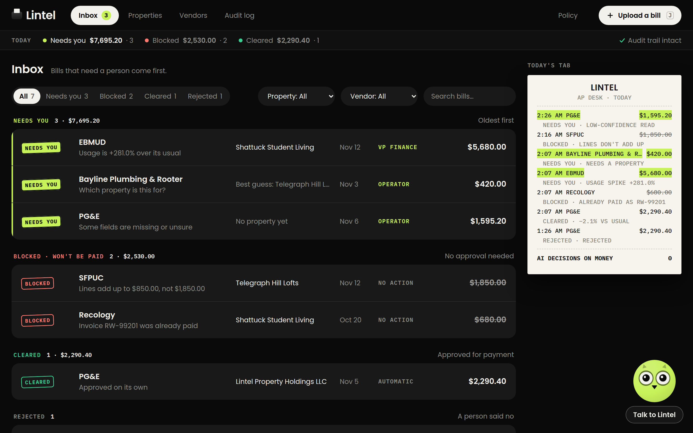
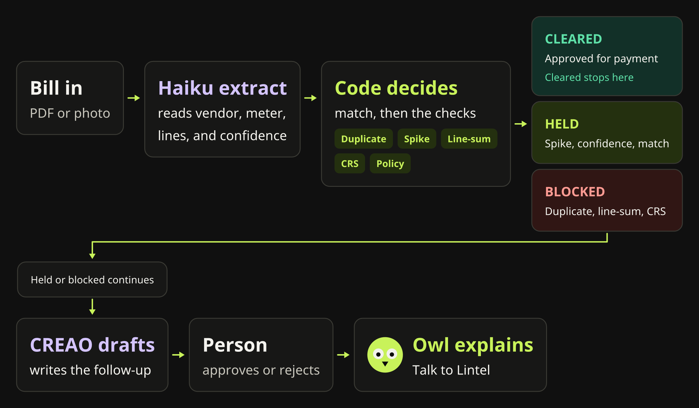
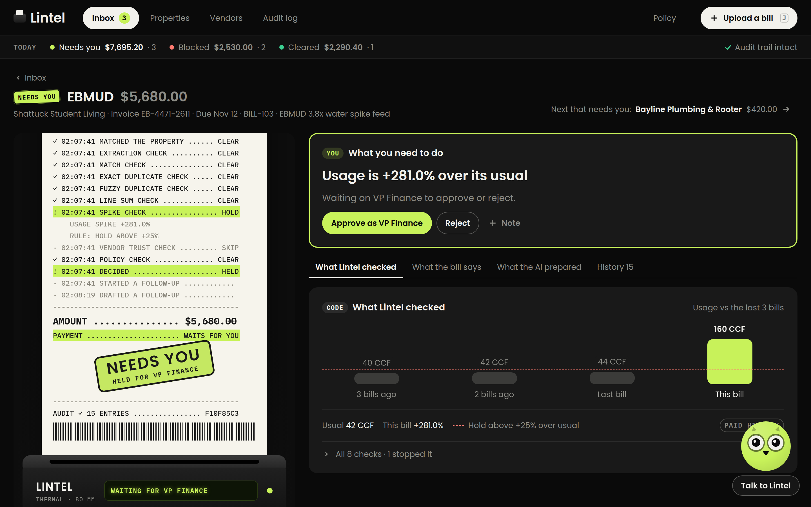
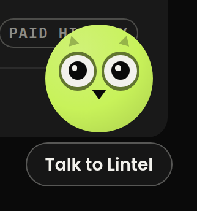

# Lintel

> The model reads the bill. Code decides whether it gets paid. Agents do the legwork. A person owns the exceptions.

Fills 2 full-time property AP and utility-audit seats on a 250-property portfolio.

[Live desk](https://lintel-brown.vercel.app/) · [Build log](hackathon.md)



## What it does

Lintel is the accounts-payable desk for a property portfolio. A PDF or a photo comes in. Claude Haiku (`claude-haiku-5-5`) reads the vendor, the meter, the lines, and a confidence on each field. Deterministic code matches the property and the vendor, then files the bill as cleared, held, or blocked. The inbox leads with whatever needs a person.

On the live desk, the EBMUD bill for Shattuck Student Living is held: 160 CCF against a 42 CCF average (+281.0%), $5,680.00 against $1,490.00 (+281.2%), threshold +25%. The why-sentence calls it a suspected leak and routes it to VP Finance. The [CREAO investigator](https://agent.creao.ai/install/cfc435a7-6765-4fb3-8c00-8d55d3c7af52?version=74747abd-5af9-4356-9c2d-ad4d86e2e0e6) (`cfc435a7-6765-4fb3-8c00-8d55d3c7af52`) has already drafted the follow-up. Claude Sonnet writes that draft when CREAO is down.

## How a bill moves



Cleared bills are approved for payment on the first row. Held and blocked bills go to CREAO, then to a person. Talk to Lintel only repeats the result.

## How a decision is made

| Who | What they do |
|---|---|
| AI | Haiku reads the document. CREAO (or Sonnet) drafts the follow-up. The owl explains the open bill, out loud, from read-only tools. |
| Code | `matchBill()` picks the property and vendor. `decide()` runs duplicate, spike, line-sum, CRS, and policy. The same mutation appends the hash-chained audit row. |
| A person | Approves, rejects, or assigns the property. Sending a draft writes an audit event. |

`decide()` is the only place a status is chosen. A field under 0.85 confidence, a 20s timeout, or a missing field holds the bill. An exact or fuzzy duplicate, a line sum that misses the printed total, or a CRS flag blocks it. A utility more than +25% over its last three bills is held. A contractor clears under the property auto-pay limit only when the vendor is verified; above $5,000 the approver is VP Finance.



Talk to Lintel sits in the corner of every desk page: a lime orb, paper eyes, a dark beak, and the words under it. After someone speaks, the transcript pill opens the lines. The tools behind the voice are GET requests. Asking it to approve leaves the bill where code put it.



## Real vs simulated

`REAL_VS_SIMULATED` used to live in `src/seed/policy.ts`. Runtime seeding and simulated payments came out, so the constant is gone. The rows below are that table, still word for word where the code still matches, including the CRS row. The opening replay is gone. A cleared bill is approved for payment; money moves only as `LIVE_TESTNET` when `LINTEL_X402_ENABLED=true` (off on the live desk).

| Component | Status | How you know |
|---|---|---|
| Guardrail engine (duplicates, spike math, policy) | REAL | Press J and type any bill; the rationale prints the arithmetic. tests/ cover every rule. |
| Property and vendor matching (account, alias, address) | REAL | Type 2450 Market St or 1880 Lombard #B and watch the match method change. |
| Human alias learning | REAL | Assign a held address once; the next bill with that string matches by HUMAN_ALIAS. |
| Bill reading from PDF/photo (intake agent) | REAL | Drop a PDF; fields arrive with confidence and source snippets. Timeout holds the bill. |
| Exception investigator agent (CREAO, Claude fallback) | REAL | Open any held bill; the brief shows the provider and, for CREAO, the run ID. |
| Append-only, hash-chained audit log in Convex auditEvents | REAL | Audit log shows each event hash; chain status is checked on every load. |
| Portfolio: 5 properties standing in for a 250-property book, 3 months of bill history | SEEDED | Properties are added on the Properties page. `src/seed/portfolio.ts` is the test fixture. |
| Usage baselines (CCF, kWh) | SEEDED | src/seed/portfolio.ts; not a utility data feed. |
| Payment execution (utility portal, ACH) | NOT RUN | A cleared bill is approved for payment. With `LINTEL_X402_ENABLED=true`, settlement is `LIVE_TESTNET` only. |
| Drafted emails and work orders | SIMULATED | Send logs an audit event; nothing leaves the app. |
| CRS Credit API vendor background check (FCRA BLJ / OFAC / Criminal) | REAL | Run CHIP-NEW-CONTRACTOR (Apex Rapid HVAC LLC, P08 Priya Venkatesan) with LINTEL_CRS_ENABLED=true; returns live Stitch Credit sandbox civil judgment ($12,300) and state tax lien ($7,450). |

## Run it

Node 20+.

```bash
npm install
cp .env.example .env.local
npx convex dev
```

Stop that process once it has written `NEXT_PUBLIC_CONVEX_URL`. `npm run dev` starts Next.js and `convex dev` together, and two Convex processes will fight.

```bash
node scripts/sync-convex-env.mjs
npm run dev
```

Open http://localhost:3000. The sync script copies non-empty server variables from `.env.local` into the deployment and does not print the values. Extra flags go to `npx convex env set`, including `--prod`.

Names only. `.env.example` ships them empty.

- `ANTHROPIC_API_KEY` — Haiku reads bills. `LINTEL_EXTRACT_MODEL` defaults to `claude-haiku-5-5`. `LINTEL_INVESTIGATOR_MODEL` defaults to `claude-sonnet-5-5`.
- `CREAO_API_KEY`, `CREAO_AGENT_ID` — investigator. The id is `cfc435a7-6765-4fb3-8c00-8d55d3c7af52`.
- `LINTEL_CRS_ENABLED`, `CRS_BASE_URL`, `CRS_API_KEY` — sandbox vendor check. The client also accepts `CRS_USERNAME` and `CRS_PASSWORD`.
- `LINTEL_X402_ENABLED` — Base Sepolia settlement.
- Voice, server-side only: `LINTEL_VOICE_TOOL_SECRET`, `CARTESIA_API_KEY`, `CONVEX_SITE_URL`, `CARTESIA_REVIEWER_AGENT_ID`. The deployed Next.js app needs `NEXT_PUBLIC_CONVEX_URL` and nothing else for voice.

```bash
node --experimental-strip-types scripts/cartesia-setup.mjs --dry-run
npm test
npx tsc --noEmit
npm run extract -- fixtures/bills/BILL-103-ebmud.pdf
```

The dry run writes nothing and calls no network. `npm test` stays off the network. The extract command prints one bill for a local PDF or photo.

The live desk runs on Convex at `https://incredible-cobra-296.convex.cloud`.

## Team

| Name | Built |
|---|---|
| Pranil Lama ([@Pranillama](https://github.com/Pranillama)) | Intake normalizer & document extraction agent (Claude Haiku 5.5), deterministic property/vendor matcher, exception investigator agent (CREAO AI + Claude Sonnet 5.5 fallback), CRS Credit API integration, sponsor setup & submission. |
| Anmol Pandey ([@axp8948](https://github.com/axp8948)) | Convex backend, deterministic guardrail & policy engine (`decide`), `processBill` orchestrator pipeline, SHA-256 hash-chained audit log, golden test suite. |
| Piyush Singh | Next.js 16 AP Command Center UI, live blotter & replay, Judge Live Test drawer, why-card & usage sparklines, audit verification drawer, demo video. |
