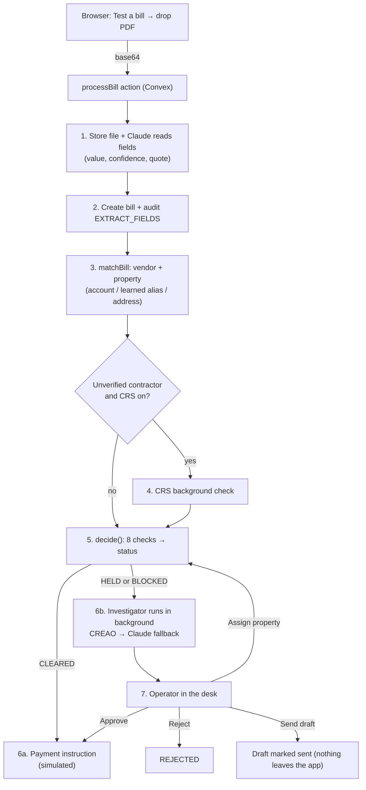

# End-to-end flow: from an uploaded PDF to payment

An uploaded PDF goes through one Convex action, `processBill`, which runs every step in order and writes each step to an audit log. Claude reads the bill, plain rule-based code (no AI) decides its fate, and a person handles anything the code won't clear on its own.

UI file names below refer to the desk under `src/components/desk/` (PR #20).

## 1. Upload in the browser

In **Test a bill**, `TestBill.tsx` turns the file into base64 text (PDF, PNG, JPEG, or WEBP). It calls `actions.processDocument`, which `useConvexDesk.ts` forwards to the Convex action `processBill` (`convex/pipeline/process.ts`). The typed form and the opening Saturday batch go through the same action. Only the reading step differs.

## 2. The AI reads the bill

`processBill` saves the raw file in Convex storage, then calls `extractDocument` (`src/agents/intake/extractDocument.ts`). That sends the file to Claude (Haiku by default, set by `LINTEL_EXTRACT_MODEL`) and makes it fill a fixed set of fields: vendor, invoice number, account, service address, dates, total, usage, and line items. Each field comes back with:

- the value,
- a confidence from 0 to 1,
- an exact quote from the document as evidence.

The prompt tells Claude to copy only what's printed and never compute a total or recommend anything. If the call times out (20 seconds) or fails, it never throws. It returns empty fields plus an error message, so the bill ends up held for a person instead of crashing.

## 3. The bill is created and logged

`createBill` stores the record and `commitExtraction` adds the first audit entry, `EXTRACT_FIELDS`. That entry passes, or halts if extraction failed.

## 4. Matching the vendor and property

`matchBill` (`src/match/matchBill.ts`) runs without any AI and tries these in order:

- **`EXACT_ACCOUNT`:** the account number exactly matches a known utility account.
- **`HUMAN_ALIAS`:** the address matches one a person assigned before.
- **`ADDRESS`:** a scored comparison of the address against the property list. Its score is capped at 0.80 when the unit isn't on that property.
- **`UNRESOLVED`:** nothing matched.

Two audit entries are written here, one for the vendor and one for the property.

## 5. Vendor background check (optional)

This runs only when the vendor is an unverified contractor and `LINTEL_CRS_ENABLED=true`. `convex/crs/vendor.ts` calls the CRS (Stitch Credit) sandbox for civil judgments, tax liens, OFAC sanctions, and criminal records. The result comes back as `PASS`, `FLAGGED`, or `UNAVAILABLE` and gets its own audit entry.

## 6. Code decides

`decide()` (`src/engine/decide.ts`) is the only place a status gets chosen. It runs eight checks from `src/engine/checks.ts`, using the numbers in `src/seed/policy.ts`:

| Check | Fails when |
| --- | --- |
| Extraction | a field is missing, a key field's confidence is under 0.85, or extraction errored |
| Match | the vendor is unknown, the property match is under 0.90, or the vendor and account conflict |
| Exact duplicate | the same vendor and invoice number were seen before |
| Fuzzy duplicate | same vendor, property, and amount within 2%, due within 20 days |
| Line sum | the line items differ from the printed total by more than $0.01 |
| Spike | usage or amount is more than 25% above the last 3 bills (fewer than 2 prior bills also holds) |
| Vendor trust | an unverified contractor wasn't checked, was flagged, or the check was unavailable |
| Policy | a utility didn't match by account, or a contractor is over the property's auto-pay limit |

The failure reasons are sorted into five priority levels:

- **BLOCKED:** a duplicate, a line-sum mismatch, or a CRS flag. A blocked bill has no pay button at all.
- **HELD:** any reason in the other four levels. It also gets a required approver: an operator for data problems, a property manager, or VP Finance for amounts over $5,000.
- **CLEARED:** nothing failed. It also gets a payment rail: the utility's portal for enrolled utilities, or ACH for contractors under their auto-pay limit.

`explain()` writes the one-sentence "why" from the same numbers. Each check and the final decision is appended to the audit log.

## 7a. A cleared bill gets a payment instruction

`commitPayment` stores the payment instruction. It's simulated: no money moves. The only exception is `LINTEL_X402_ENABLED=true` for non-utility vendors, which tries a settlement on a test network.

## 7b. A held or blocked bill gets investigated

`processBill` marks the investigation as pending and schedules `investigate.run` in the background, then returns immediately. The investigator tries CREAO first and falls back to Claude Sonnet if CREAO fails (for example, a 429 rate limit). It gets the bill, its property and vendor, the last 6 bills from the same vendor, related live bills, and the policy text. It returns a summary, findings, and a draft email or work order. If the investigation somehow changed the bill's status, `finish` throws, so the AI can't move money or change a decision.

## 8. The desk updates live

The UI subscribes to `listBills`, so the new bill appears in the tabs right away. The investigator's brief fills in a few seconds later. On the page, the bill's four cards follow the flow: **Read in** (what the AI read), **Code decided**, **Agent drafted**, and **You decide**.

## 9. The person decides

`humanResume` (`convex/bills/resume.ts`) first asks `humanRefusal` whether the action is allowed. That's how blocked bills refuse approval. The four actions:

- **Approve:** the bill becomes `CLEARED` with a simulated payment on the vendor's default rail, and the approver's role is logged.
- **Assign property:** the bill gets the chosen property at confidence 1.0, and the address is saved as an alias. All eight checks then run again with the corrected match, so a bill that now passes clears without further approval. The next bill with that address matches automatically by `HUMAN_ALIAS`.
- **Reject:** the bill becomes `REJECTED`.
- **Send draft:** the draft is marked sent and logged. Nothing actually leaves the app.

## The audit trail

Every step above appends an event through `appendEvents`. Each event's hash is SHA-256 of the previous event's hash plus its own fields (`src/audit/chain.ts`). `listBills` re-checks the whole chain on every load, and the desk shows the result as "Chain intact."

## Try it

Drop any file from `fixtures/bills/` into Test a bill. For example, `BILL-103-ebmud.pdf` is held for a usage spike, and `CHIP-FUZZY-DUP-recology.pdf` is blocked as a duplicate.
